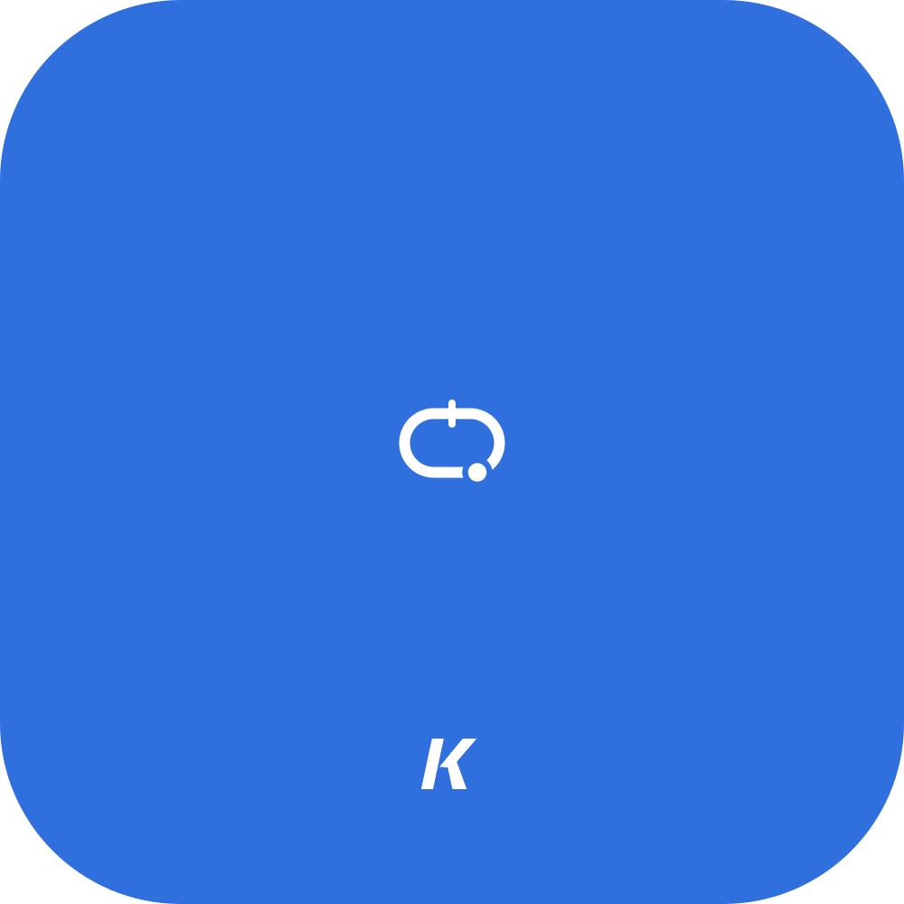

<p align="center"></p>

# Daily lap

A two-minute daily habit: one lap, one new track, and a link that lets a friend race your exact lap. It runs in a phone browser. No login, no app, no server.

### [Play today's lap → datakyle.github.io/miniracer](https://datakyle.github.io/miniracer/)

Open it on your phone. Hold the left or right side of the screen to steer. When you finish, tap **Share best** and send the link to a friend. They race your ghost on the same track.

- **A new track every day.** The date seeds a procedural generator, so everyone gets the same track.
- **Two buttons.** Hold the left or right half of the screen (or ← → / A D). The car drives itself, and steering hard makes it slide.
- **One lap.** Walls slow you down but never end the run. Press ↺ (or R) to restart at any time.
- **About 10 seconds a lap.** Short enough to run it ten times in a coffee break.
- **A starter ghost.** Every track comes with Sam, a below-average driver to race against your first time. Most players beat Sam within a few tries.
- **Race your friends.** "Share best" sends a link that holds your whole lap. Your friend races your ghost, and everyone whose ghost you have shows up on the day's board.

Inspired by Reddit's [Mini Racer](https://github.com/shimrut/mini-racer). All code here is original.

## How sharing works without a backend

A lap is stored as one steering input (-1, 0, +1) per 1/120 s physics step. It is
run-length encoded, varint packed and base64url'd into the URL fragment:

```
https://…/#c=2026-10-10.17557.kyle.oAEFSQU6BUMI…
            date       ms    name  inputs
```

The fragment never reaches a server. When a friend opens the link, their browser
**re-simulates the lap**. The time shown is the replayed time, and a link whose claimed
time matches the replay gets a "verified" tag. Hand-editing the time in the link
doesn't work.

This only holds because the simulation is deterministic on every device.
`Math.sin`, `cos`, `exp` and `pow` can differ in the last bit between JS engines,
so the simulation and track generator use only `+ - * /` and `Math.sqrt` (all exactly
specified by IEEE 754). Sin and cos come from a Taylor polynomial in `src/core/dmath.js`.

## Design

This is the dark inversion of the Kyle Bautista design language: Inter at 400/500/600, `#1d1d1f` surfaces, hairline borders instead of shadows, and sentence case. Blue (`#0d74ce`) appears only on actions. Warm amber (`#B8906A`) appears once per screen, as the brand dot, and as the player's car. The tokens live at the top of `src/styles.css`. Track palettes are in `THEMES` in `src/core/track.js`.

## Layout

```
src/core/        pure, deterministic, no DOM
  rng.js         string hash + mulberry32
  dmath.js       deterministic sin/cos
  track.js       procedural track: polar points -> centripetal Catmull-Rom -> resample -> validate
  sim.js         car physics (auto throttle, yaw, grip/drift, walls, checkpoints, sub-frame finish)
  bot.js         pursuit driver: proves the track is drivable; a laggy variant drives Sam, the starter ghost
  replay.js      input codec
  day.js         date -> { track, bot lap, starter ghost }
src/game/        browser side
  render.js      canvas renderer (themes, curbs, skid marks, ghosts, scenery)
  input.js       multi-touch halves + keyboard
  audio.js       procedural engine / tyre / bump sounds
  share.js       challenge links + verification
  storage.js     localStorage (bests, ghosts, friends, streak)
  ghosts.js      which ghosts exist for a day; the seam for a future shared ghost server
src/main.js      game loop, screens
```

## Run

```
npm install
npm run dev        # http://localhost:5173  (add ?bot to let the bot drive, dev only)
npm test
npm run build      # optional: minified static site in dist/
```

## Deploy

The game is live at **https://datakyle.github.io/miniracer/**.

GitHub Pages serves the `main` branch as-is (Settings → Pages → "Deploy from a branch", `main`, `/ (root)`). The source is plain ES modules with relative paths, so it runs in the browser with no build step: every push to `main` is live a minute later. `.nojekyll` stops Pages from running Jekyll on it.

`.github/workflows/ci.yml` runs the tests and a Vite build on every push, so a broken change shows up as a red check.

For other static hosts, either serve the repo root or run `npm run build` and upload `dist/`. Both work from any path.

## Tuning

- Handling: `TUNING` in `src/core/sim.js`
- Track shape and size: constants at the top of `src/core/track.js`
- Lap length: `MIN_LENGTH` / `MAX_LENGTH` in `src/core/track.js` (175 to 235 units is about 9 to 11 s)
- Starter ghost: `ROOKIE_NAME` in `src/core/day.js`, and the `slowdown` in `rookieLap` (`src/core/bot.js`)

Changing any of these changes the tracks or the physics, so old challenge links stop
verifying.
